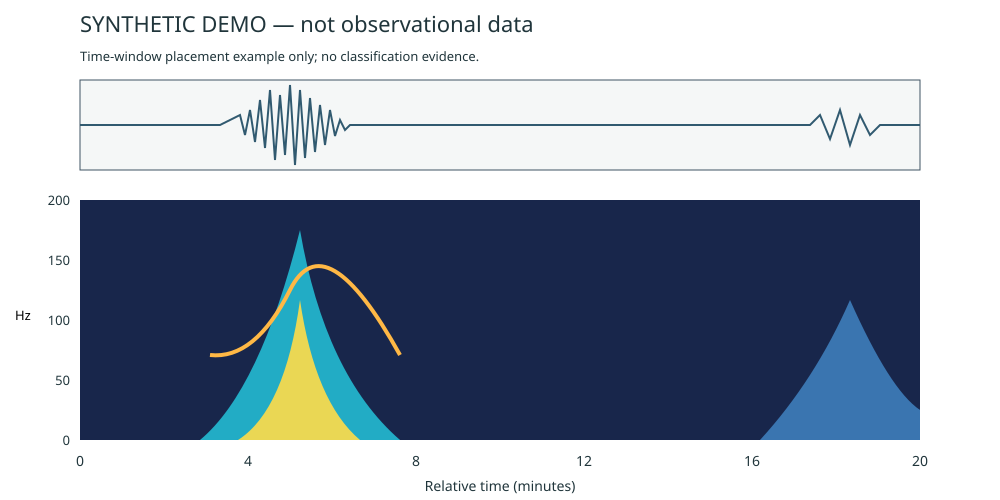

# Animal seismic visual review

A Codex skill for interpreting desert nodal-geophone waveform and spectrogram images using an expert's reviewed visual distinctions. It records candidate source classes, evidence, uncertainty, and estimated event windows, then draws numbered windows directly over the spectrogram.

**中文：** 将人工复核的波形与时频谱经验整理为视觉判断流程，输出类别、依据、置信度和估计时间窗，并在时频谱上显示对应矩形框。原图不变，标框可以隐藏。

Version **1.1.0** adds time-window annotations. The recognition rules retain their v1.0 provenance. This is an empirical interpretation workflow, not a trained neural-network classifier. No accuracy has been established by this public package.

## What it recognizes

| Code | Candidate source |
|---|---|
| `vehicle` | Vehicle / 汽车 |
| `sheep_flock` | Sheep flock / 羊群 |
| `tarim_hare` | Tarim hare / 塔里木兔 |
| `gerbil` | Gerbil / 沙鼠 |
| `earthquake_like` | Earthquake-like morphology, without seismic confirmation |
| `animal_unspecified`, `other_or_uncertain`, `no_clear_event` | Insufficient or different evidence |
| `mixed` | Distinct source types in separate or overlapping event intervals |

The written rules were derived from 15 reviewed teaching images with 26 annotated regions. Those counts are not independent event counts. The public repository now includes all 15 reviewed teaching images, the original expert descriptions, and 26 region annotations. Browse the [illustrated teaching cases](references/teaching-cases.md), [structured records](references/teaching_records.json), and [data provenance](references/DATA_PROVENANCE.md). Raw data, the full workbench database, blind-test images, predictions, and answers are not included.

## Use the skill

Use the repository as a skill folder named `animal-seismic-visual-review`, or copy `SKILL.md`, `references/`, and `scripts/` into that folder under your Codex skills directory. Preserve any existing local teaching case pack when updating. The entry point is [SKILL.md](SKILL.md).

Example request:

> Use $animal-seismic-visual-review to classify these waveform/spectrogram images. Use my reviewed teaching cases, keep the answers closed, and return per-event evidence, uncertainty, numeric time intervals, and numbered time-window boxes over each spectrogram.

Open the relevant included images and descriptions before predicting. If using a stripped installation without the case pack, disclose reliance on written rules alone. Do not treat a prediction as a verified animal observation.

## Run the annotation example

The renderer uses only the Python standard library, Python **3.9 or later**. It does not call a model or classify images; it renders supplied windows.

Run from the repository root after cloning or downloading the complete repository:

```bash
python3 -m venv .venv
.venv/bin/python -m pip install -r requirements.txt
.venv/bin/python scripts/render_windows.py examples/annotations.json examples/report.html
.venv/bin/python -m unittest discover -s tests -v
```

On Windows, use `.venv\Scripts\python.exe` in place of `.venv/bin/python`; Windows has not been tested. The input manifest and synthetic SVG are included. The expected output is `examples/report.html` with two numbered boxes and legends for approximately 03:30–07:18 and 17:00–20:00. No API key, network inference, or paid service is needed for this renderer example.

Open `examples/report.html` in a browser. The supplied graphic is synthetic, solely for demonstrating annotation geometry; it is not a geophone observation, teaching example, or classification benchmark. Keep the relative image paths intact when moving the generated HTML.



## Output contract

- Preserve the source image and record its dimensions, time-axis limits, and spectrogram bounds.
- Return a summary row per image and evidence, alternatives, and confidence per event.
- Record `start_seconds` and `end_seconds` and display matching `mm:ss` windows relative to the plot's time origin.
- Draw numbered boxes and a matching class/time/confidence legend. A full-height box identifies time only, not occupied bandwidth.
- Mark image-derived boundaries as estimates. A value such as `07:18` is a notation conversion, not proof of second-level accuracy. A window ending at the image edge may be truncated.
- Preserve frozen classifications and checksums when adding annotations or comparing answers later.

See the [output schema](references/output-schema.md) and [recognition rules](references/recognition-rules.md). Plot calibration must be checked for each layout; there are no universal pixel coordinates or frequency thresholds.

## Validation and limits

The included tests cover time-to-pixel mapping, nonzero time origins, rejected invalid windows, safe text rendering, and end-to-end HTML output. The documented example and tests were run in a clean venv with CPython **3.14.7**, **macOS 27.0**, **arm64** (Apple Silicon CPU); no GPU is required or used. Python 3.9+ compatibility is intended; only 3.14.7 was executed. Teaching-pack checks also validate all image hashes, normalized regions, and preservation of descriptions. These checks validate the renderer, not species classification accuracy. Color saturation, unequal colorbars, persistent background lines, and incomplete event windows can all affect visual interpretation.

## Maintainer and publication scope

Maintained by [Pengchao He](https://github.com/Pengchao-He). The empirical distinctions originate from the maintainer's reviewed annotations; implementation and packaging were assisted by Codex.

Initial labels were attributed by the maintainer to **宇潭**; the published region reviews and descriptions are Pengchao He’s. The preferred full credit for the initial label contributor and the complete report co-author/co-developer list await author confirmation. No third-party source code or third-party Python packages are bundled. The implementation uses Python’s standard library and browser HTML/SVG rendering; recognition rules derive from the documented teaching snapshot, rather than a published fitted model.

## CWP submission metadata and preparation status

Full CWP preparation was requested on 2026-10-29. The working standard is the maintainer-supplied CWP checklist, not an independently verified institution-wide policy. See the [requirement-by-requirement audit](CWP_AUDIT.md).

- **CWP report number and year:** pending author input. This package is not yet associated with a confirmed report number.
- **Public developer email:** pending author input and confirmation that it will remain valid through the report year. The GitHub profile above is a contact route, not a substitute for the required email.
- **Complete report authors and code contributors:** pending confirmation; known contributions are credited above.
- **License:** pending rights-holder selection. No root reuse license is in force yet. Public posting of reviewed cases was authorized; public visibility alone does not grant a reuse license. Code/skill and teaching-data terms will be documented separately once selected.

The repository is therefore **not yet fully CWP-ready**. No report identifier, contact address, rights ownership, or license grant has been invented.

## Dependencies

[requirements.txt](requirements.txt) records the versioned runtime requirement: CPython 3.9+ (tested 3.14.7), with no third-party packages. Python’s bundled `venv`, `pip`, and `unittest` support setup and verification. A browser supporting HTML5 and SVG is needed to view the output; the visual layout was checked in Codex’s in-app browser on macOS. No compiler, CUDA stack, external geophysics package, or GPU is required.

For **classification**, a vision-capable agent must read the skill and teaching images. The renderer is only a deterministic display utility; this repository does not bundle a model, API client, or calibrated classifier. The original run used Codex; its exact model/build was not recorded here, so identical predictions across agents are not guaranteed.
