# Teaching cases / 教学案例原文

User-reviewed records, workbench revision 173. The original on-image labels may be wrong; follow the reviewed category for the specified region. Mechanism explanations are hypotheses unless independently verified.

These are the user’s verbatim notes, including uncertainty and any contradictions between the evidence field and prose.

## ppt-s10-i1

Wild animal spectrugram labels 10272026.pptx / 第 10 页 / 图 1

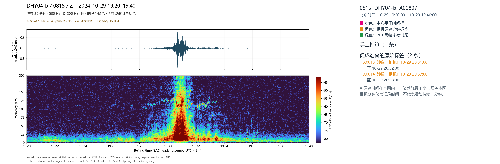

**Original PPT text (unverified):** Vehicle

**Whole-image notes:** 

### ppt-s10-i1 / event 1

Reviewed label: 车辆
User confidence: 高
Evidence field: 主要依据波形 / 时频谱经验
Time field: not supplied; use drawn region
Region: {"x": 0.2597258254716981, "y": 0.1739997126643201, "w": 0.20897110849056605, "h": 0.7075012570935996}

Description:
### 车辆振动信号的典型特征

车辆经过观测台站时产生的振动信号，主要具有以下四个特征：

1. **持续时间为分钟量级。** 整个车辆事件通常持续一分钟左右，在时频谱上表现为一个连续的振动过程。

2. **时频谱呈近似三角形的分布。** 随着车辆由远及近，振动能量逐渐增强，可观测到的频带也逐渐拓宽。当车辆距离观测台站最近时，信号能量最强，频带通常也最宽。随后，随着车辆远离，振动能量逐渐减弱，频带逐渐收窄。因此，时频谱整体呈现近似三角形的轮廓，但两侧边界并非直线，而是具有一定曲率的弧线。

3. **存在发动机产生的窄带变频信号。** 发动机及相关机械部件的周期性振动，会在时频谱中形成一系列窄带频率成分，包括基频及其倍频。这些频率可能随着发动机转速的变化而升高或降低，在时频谱上表现为多条短小、断续且不规则的弯曲条带，可作为车辆振动信号的辅助识别特征。

4. **时域波形呈现中间强、两侧弱的包络特征。** 在时域波形中，随着车辆逐渐接近观测台站，振动幅值逐渐增大；当车辆经过距离台站最近的位置时，波形幅值达到最大；随后随着车辆逐渐远离，振动幅值逐渐减小。因此，整个车辆事件的时域波形呈现出明显的**中间振幅大、两侧振幅逐渐衰减**的特征，形成一个近似钟形或隆起状的振幅包络。

**综合来看，车辆振动信号的识别特征包括：分钟量级的持续时间、近似三角形且具有弧形边界的时频分布、发动机相关的窄带变频曲线，以及时域波形中间强、两侧弱的振幅包络。**

## ppt-s10-i2

Wild animal spectrugram labels 10272026.pptx / 第 10 页 / 图 2

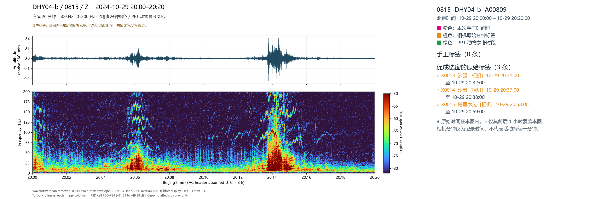

**Original PPT text (unverified):** Vehicle

**Whole-image notes:** 

### ppt-s10-i2 / event 1

Reviewed label: 车辆
User confidence: 高
Evidence field: 主要依据波形 / 时频谱经验
Time field: not supplied; use drawn region
Region: {"x": 0.17894366448118587, "y": 0.17001302365964835, "w": 0.09562517816419613, "h": 0.7076595398306925}

Description:
### 图二 — Case 1：疑似小型车辆振动信号

图二中的第一个 Case 同样表现出典型的车辆振动特征，但其振动能量相对较弱，推测可能对应一辆体型相对较小的车辆。

与图一中频谱能量覆盖约 0–200 Hz 的车辆信号不同，该信号的主要能量集中在 **0–75 Hz** 范围内，表现出相对较窄的主能量频带。

在 **75 Hz 以上的频段**，可以观察到多条明显的窄带变频曲线。这些曲线的频率随时间升高或降低，并伴有较为清晰的谐波（倍频）结构，可能与发动机转速变化及相关机械振动有关。

**这一案例最突出的特征是：低频能量主要集中在 0–75 Hz，而高频区域的变频轨迹和谐波结构尤为明显。**

### ppt-s10-i2 / event 2

Reviewed label: 车辆
User confidence: 高
Evidence field: 主要依据波形 / 时频谱经验
Time field: not supplied; use drawn region
Region: {"x": 0.39552896949828964, "y": 0.16929400911656176, "w": 0.1295966362599772, "h": 0.7057331235077057}

Description:
Case 2：相对较大车辆的振动信号

第二个案例的整体振动能量明显强于 Case 1，推测对应一辆体型相对较大的车辆。

这一判断的重要依据是：两个案例均由同一个观测台站记录，且附近主要只有一条道路，因此车辆与台站之间的传播距离基本可比。 在这种情况下，传播距离差异对信号能量的影响相对有限，可以利用观测到的振动能量大小辅助判断车辆的相对体型。

与 Case 1 相比，Case 2 不仅整体振动能量更强，相关的背景振动及窄带变频、谐波信号也更加显著。

尽管两个案例的能量强度存在差异，但其基本特征高度一致：

时域波形： 呈现中间振幅大、两侧逐渐衰减的包络形态，对应车辆由远及近、再逐渐远离观测台站的过程。

时频谱： 呈现近似三角形且两侧边界弯曲的能量分布，车辆最接近台站时，信号能量最强、可观测频带最宽。

机械振动特征： 均可观察到与车辆发动机或其他旋转机械相关的窄带变频及谐波结构。

总体而言，图二的两个案例进一步表明，不同车辆产生的振动信号虽然在能量强度和频率分布上存在差异，但其时域包络和时频结构具有较高的一致性。

## ppt-s11-i1

Wild animal spectrugram labels 10272026.pptx / 第 11 页 / 图 1

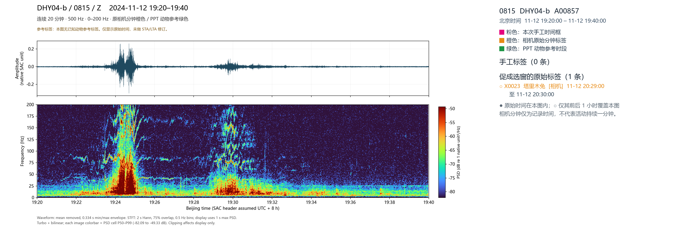

**Original PPT text (unverified):** Vehicle

**Whole-image notes:** 

### ppt-s11-i1 / event 1

Reviewed label: 车辆
User confidence: 高
Evidence field: 主要依据波形 / 时频谱经验
Time field: not supplied; use drawn region
Region: {"x": 0.11028809150513112, "y": 0.1716274148035598, "w": 0.147417509977195, "h": 0.7010798784458433}

Description:
Case 1：具有双峰特征的典型车辆振动信号

该案例同样表现出非常典型的车辆振动特征。无论是时域波形还是时频谱，其整体形态均与前面描述的车辆信号高度一致。

该案例最显著的特点是出现了两个时间间隔较近的能量峰值。 目前尚不能明确解释这一双峰现象的具体成因。一种可能是两辆车在较短时间内相继经过观测台站；另一种可能是道路局部存在起伏或不平整，使同一辆车经过不同位置时产生了两次较强的振动响应。这一现象仍需进一步分析。

尽管双峰的形成机制尚不明确，但该信号的车辆来源具有很高的可信度，主要依据包括：

时域波形： 整体仍呈现车辆接近和远离台站过程中典型的振幅变化特征，只是存在两个相邻的明显峰值。

时频谱形态： 能量分布的整体轮廓及频率覆盖范围与前述典型车辆信号基本一致。

变频与谐波特征： 在接近 100 Hz 以及 100–200 Hz 的频率范围内，可以观察到明显的窄带变频轨迹，以及具有倾斜、弯曲形态的谐波（倍频）条带。这些特征与车辆发动机及相关机械振动的频率变化规律相符。

总体而言，该案例可以高度可信地识别为车辆振动信号。其主要特殊之处在于两个相邻的能量峰值，而这一双峰现象究竟来自两辆车连续经过，还是单辆车与道路局部条件的相互作用，目前仍有待确认。

### ppt-s11-i1 / event 2

Reviewed label: 车辆
User confidence: 高
Evidence field: 主要依据波形 / 时频谱经验
Time field: not supplied; use drawn region
Region: {"x": 0.28480437571265677, "y": 0.17619926199261993, "w": 0.1361976197263398, "h": 0.7005914912090297}

Description:
Case 2：具有非对称时频特征的车辆振动信号

第二个案例同样具有非常典型的车辆振动特征，可以高度可信地判断为车辆产生的信号，但其整体形态的对称性不如前面的案例明显。

在时频谱上，信号整体仍呈现近似三角形的能量分布，但具有一定的不对称性，尤其是在车辆远离台站后，信号形成了一条相对较长的尾部，表现出较为明显的拖尾现象。

在时域波形上，信号仍具有典型的振幅包络特征：随着车辆由远及近，振动幅值逐渐增强；在车辆接近观测台站时达到峰值；随后随着车辆远离，振幅逐渐减弱。整体上仍表现为中间强、两侧弱的包络形态。

在频率特征上，75–200 Hz 范围内存在非常清晰的窄带变频信号，并伴有可能与发动机及相关机械振动有关的谐波结构。这些特征进一步提供了识别车辆振动信号的重要依据。

此外，该案例的整体振动能量相对较弱，结合前述同一台站、同一道路的观测条件，推测其可能对应一辆体型相对较小的车辆。

总体而言，该案例的主要特点是时频分布具有一定的不对称性，并存在明显的拖尾现象，但其时域振幅包络、近似三角形的时频结构，以及 75–200 Hz 范围内清晰的变频特征，均与典型车辆振动信号高度一致。

## ppt-s12-i1

Wild animal spectrugram labels 10272026.pptx / 第 12 页 / 图 1

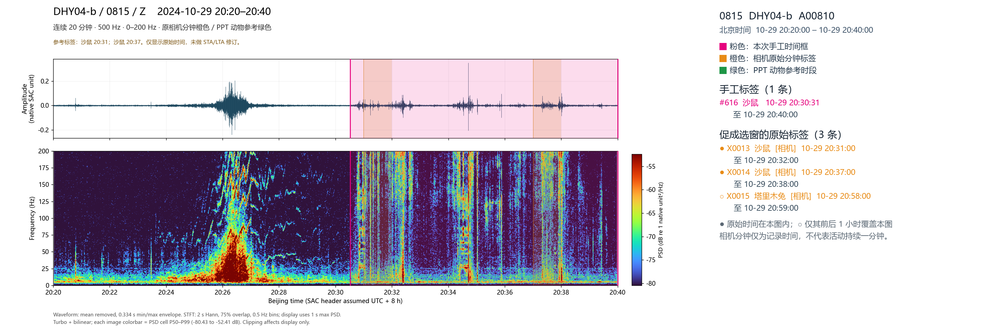

**Original PPT text (unverified):** Vehicle vs. 
沙鼠

**Whole-image notes:** 

### ppt-s12-i1 / event 1

Reviewed label: 车辆
User confidence: 高
Evidence field: 主要依据波形 / 时频谱经验
Time field: not supplied; use drawn region
Region: {"x": 0.13796589937286202, "y": 0.17543954851313218, "w": 0.18847544897377422, "h": 0.6966843933145215}

Description:
 Case 1：典型的大型车辆振动信号

该案例可以明确识别为车辆振动信号，而且其特征非常典型，与前面各个车辆案例所表现出的规律高度一致。

在时频谱上，该信号呈现出非常清晰的近似三角形能量分布，两侧边界较为完整，整体形态十分典型。随着车辆由远及近，信号能量逐渐增强，频带逐步展宽；当车辆距离观测台站最近时，信号达到最强，对应时频谱中部出现明显的能量峰值；随后随着车辆远离，信号能量逐渐减弱，频带也逐步收窄，形成完整而清晰的三角形轮廓。

在频率特征上，除 75–200 Hz 频段存在明显的窄带变频信号外，在更低频的 25–50 Hz 范围内，也已经可以观察到一定的变频成分。这些随时间变化的窄带频率轨迹，进一步反映了车辆发动机及相关机械系统的振动特征，为车辆识别提供了重要依据。

在时域波形上，该信号同样具有典型的包络特征，即振幅随车辆接近而逐渐增大，在最接近台站时达到峰值，随后随着车辆远离而逐渐减小，整体呈现出一个较为对称且完整的振幅包络形态。

综合来看，无论是清晰的三角形时频结构、中部突出的能量峰值、低频至中高频范围内明显的变频信号，还是时域波形中典型的包络特征，都表明该案例毫无疑问是车辆振动信号。结合其整体能量水平判断，该信号很可能对应一辆相对较大的车辆。

### ppt-s12-i1 / event 2

Reviewed label: 沙鼠
User confidence: 高
Evidence field: 相机确认，已核对对应时段
Time field: not supplied; use drawn region
Region: {"x": 0.34816401795895097, "y": 0.1717495116127632, "w": 0.23490058437856326, "h": 0.704362925982201}

Description:
### 图四 — Case 2：沙鼠活动产生的典型振动信号

该案例可以明确识别为**沙鼠活动产生的振动信号**。这一判断不仅基于振动信号的时域和时频特征，也得到了现场相机观测结果的支持。

**1. 时域波形特征**

在时域波形中，可以观察到一系列短暂、尖锐的脉冲峰值。这些峰值可能对应沙鼠跳跃时身体或四肢撞击地面所产生的瞬态振动。

与车辆信号中相对连续、平滑的振幅包络不同，沙鼠活动呈现出明显的间歇性。沙鼠并非持续不断地跳跃，而是可能连续跳跃数次后短暂停顿，进行其他活动，然后再次跳跃。因此，波形中的脉冲信号表现为**间歇性出现、强弱不一、分布不规则**的特征。

**2. 时频谱中的宽频竖向条带**

在时频谱上，最显著的特征是大量短时、宽频的竖向能量条带。这些条带通常贯穿 **0–200 Hz** 的整个观测频段，反映了瞬态冲击所产生的宽频振动。

每一条竖向条带可能对应沙鼠的一次跳跃或落地冲击。由于沙鼠的活动并不连续，这些竖向条带在时间上也呈现出不规则分布，表现为时有时无、时强时弱，有时密集出现，有时则存在明显的间隔。

**3. 局部频率增强与横向能量连接**

除宽频竖向条带外，沙鼠信号还表现出一些值得注意的频率结构：

- **局部频率亮斑：** 在某些特定频率范围内，可以观察到相对集中的高能量区域，表现为局部亮斑，说明这些频段存在一定的能量增强现象。
- **弱横向能量条带：** 在相邻的竖向冲击条带之间，可以隐约观察到一些横向延伸的能量结构，似乎将不同时间出现的竖向条带连接起来。这可能反映了沙鼠跳跃间隙的持续活动，或某些频率成分的持续振动。

在当前案例中，这些横向能量结构虽然能够初步辨认，但还不够清晰和典型，其具体形成机制仍需要进一步分析。

**4. 与塔里木兔振动信号的潜在区别**

值得注意的是，后续的塔里木兔案例同样表现出明显的瞬态宽频冲击特征，即在 0–200 Hz 范围内出现一系列竖向能量条带。

但根据目前的观察，**两者的一个潜在区别在于竖向条带之间是否存在横向能量连接：**

- **沙鼠：** 除竖向宽频冲击条带外，还可能出现局部频率亮斑，以及连接相邻冲击事件的弱横向能量条带。
- **塔里木兔：** 同样具有明显的宽频竖向冲击条带，但条带之间的横向能量连接通常不明显。

**总体而言，本案例展示了沙鼠活动振动信号的典型特征：时域中不规则、间歇性出现的尖锐脉冲，时频谱中贯穿 0–200 Hz 的宽频竖向条带，以及局部频率增强和隐约可见的横向能量连接。** 结合现场相机记录，可以确认该案例的信号来源为沙鼠。横向能量连接是否能够成为区分沙鼠与塔里木兔的稳定特征，仍需要通过更多案例进行验证。

## ppt-s13-i1

Wild animal spectrugram labels 10272026.pptx / 第 13 页 / 图 1

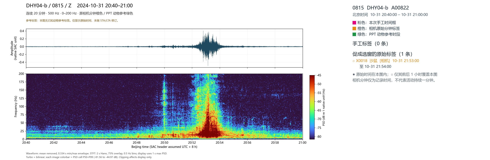

**Original PPT text (unverified):** 车前鼠
波形图很微弱
；时频谱很清晰

**Whole-image notes:** 

### ppt-s13-i1 / event 1

Reviewed label: 车辆
User confidence: 高
Evidence field: 主要依据波形 / 时频谱经验
Time field: not supplied; use drawn region
Region: {"x": 0.3457365307867731, "y": 0.17151888430649012, "w": 0.15931442417331815, "h": 0.7042543954851314}

Description:
### 当前片段：典型车辆振动信号

该片段再次呈现出非常典型的车辆振动特征。无论是时域波形还是时频谱，其整体形态均与前面识别出的车辆信号高度一致。

**1. 时域波形特征**

在时域波形中，信号呈现出明显的振幅包络：随着车辆由远及近，振动幅值逐渐增大；当车辆距离观测台站最近时，振幅达到峰值；随后随着车辆逐渐远离，振幅逐渐减小。整体表现为**中间强、两侧弱的连续包络形态**。

**2. 时频谱特征**

在时频谱上，信号呈现出清晰的近似正三角形能量分布，两侧边界并非直线，而是具有一定曲率的弧线。

随着车辆接近，信号能量逐渐增强，可观测频带逐步拓宽；在车辆最接近台站时，频带达到最宽；随后随着车辆远离，频带逐渐收窄，形成典型的**两侧为弧线的三角形时频包络**。

**3. 发动机相关的变频信号**

与前面部分车辆案例相比，该片段中的窄带变频信号并不十分突出，这可能与时频谱的颜色标尺（color bar）设置及动态范围有关。

不过，仔细观察仍然能够辨认出一些随时间变化的窄带频率轨迹。这些信号可能与车辆发动机及相关机械部件的周期性振动有关，进一步支持车辆来源的判断。

**总体而言，该片段具有典型的车辆振动特征：时域波形呈现由弱到强再到弱的连续振幅包络，时频谱呈现两侧为弧线的近似三角形结构，并伴有相对较弱但仍可辨认的发动机相关变频信号。综合这些特征，可以高度可信地将其识别为车辆振动事件。**

## ppt-s14-i1

Wild animal spectrugram labels 10272026.pptx / 第 14 页 / 图 1

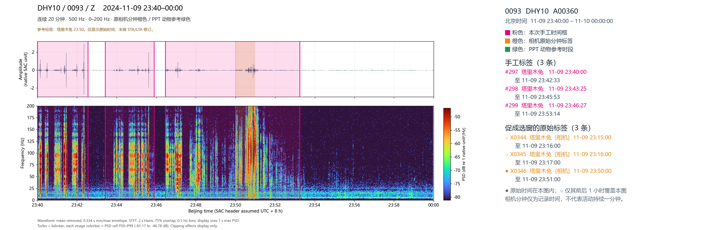

**Original PPT text (unverified):** 兔鼠对比
前两个应该都是鼠
23:46-48
应该是沙鼠 
20:50-20-52 
才是兔
沙鼠在时频谱上有横向的条带 兔子就没有。观察了很多样本 都是这样。可能跟动作特征有关。可以根据这个区分兔子和沙鼠。但也不是百分百。下面这张就不显著
。

**Whole-image notes:** 

### ppt-s14-i1 / event 1

Reviewed label: 沙鼠
User confidence: 高
Evidence field: 主要依据波形 / 时频谱经验
Time field: not supplied; use drawn region
Region: {"x": 0.05117321123147092, "y": 0.17462556978510962, "w": 0.24927843500570127, "h": 0.7024500759713479}

Description:
### 当前图：沙鼠与塔里木兔振动信号的典型对比

这张图展示了两个非常具有代表性的动物活动振动信号：**第一个视窗为沙鼠（Gerbil），第二个视窗为塔里木兔（Tarim hare）**。两个案例均有相机观测作为物种识别依据，为比较不同动物的振动特征提供了可靠的参考。

### Case 1：沙鼠振动信号

第一个案例非常清晰地展示了沙鼠活动的典型振动特征。

**1. 时域波形特征**

波形中出现一系列短暂而尖锐的脉冲峰值，可能对应沙鼠跳跃、落地或其他活动产生的瞬态地面冲击。这些脉冲在时间上呈现不规则、间歇性的分布。

**2. 时频谱中的宽频竖向条带**

时频谱上出现大量贯穿约 0–200 Hz 频段的竖向能量条带。每条竖向条带对应一次短时宽频振动事件，可能与沙鼠跳跃或落地有关。

**3. 离散频段的能量增强与横向连接**

这是该案例最突出、也最具有辨识度的特征。

在时频谱中，除了竖向宽频条带外，还可以观察到若干相对稳定的能量增强频带。例如，在 **50–75 Hz、75 Hz 附近以及 100 Hz 附近**，存在局部较强的能量集中区域。

这些增强并非严格对应某个固定频率，而是分布在具有一定宽度的频率范围内，表现为局部高能量斑块。

更重要的是，这些频段中的能量在时间方向上具有一定的连续性，从而形成**连接相邻竖向冲击条带的横向能量纹理**。

因此，沙鼠信号的时频谱呈现出一种独特的组合结构：**宽频竖向冲击条带 + 离散频段的能量增强 + 横向能量连接**。

### Case 2：塔里木兔振动信号

第二个案例经现场相机明确确认为塔里木兔，其振动信号同样具有明显的瞬态冲击特征，但时频结构与沙鼠存在显著差异。

**1. 时域波形特征**

波形中同样表现出一系列短暂而尖锐的脉冲峰值，可能对应塔里木兔跳跃、落地时产生的地面振动。

**2. 时频谱中的宽频竖向条带**

与沙鼠类似，塔里木兔的信号在时频谱上同样表现为贯穿约 0–200 Hz 的宽频竖向能量条带，反映了短时冲击事件的宽频特征。

**3. 缺少明显的横向能量连接**

与沙鼠信号不同，塔里木兔的竖向能量条带之间并没有明显的横向能量纹理将其连接起来。

同时，塔里木兔在频率方向上的能量分布相对平滑，没有像沙鼠那样，在若干离散频段形成突出的局部能量增强斑块。

因此，塔里木兔的时频谱主要由**相对独立的宽频竖向冲击条带**构成，缺少沙鼠信号中显著的横向连接结构和局部频带增强。

### 两类动物信号的关键区别

| 特征 | 沙鼠 | 塔里木兔 |
|---|---|---|
| 时域波形 | 尖锐、间歇性脉冲 | 尖锐、间歇性脉冲 |
| 时频谱竖向条带 | 明显，覆盖约 0–200 Hz | 明显，覆盖约 0–200 Hz |
| 离散频段能量增强 | 明显，存在多个局部高能量频带 | 不明显，频率分布相对平滑 |
| 横向能量连接 | 明显，可连接相邻竖向条带 | 不明显，竖向条带相对独立 |
| 物种确认依据 | 相机观测 | 相机观测 |

### 总结

**这两个案例最重要的发现是：沙鼠与塔里木兔虽然都能产生典型的宽频瞬态冲击信号，但它们在时频谱的能量组织方式上存在明显差异。**

沙鼠信号除了竖向冲击条带外，还具有多个离散频段的局部能量增强，以及连接不同冲击事件的横向能量纹理；而塔里木兔的信号主要表现为相对独立的竖向宽频条带，频率方向上的能量分布更加平滑。

这些差异为利用地震振动信号区分沙鼠和塔里木兔提供了潜在的判别特征。需要进一步通过更多相机标注案例验证其稳定性和可重复性。

### ppt-s14-i1 / event 2

Reviewed label: 塔里木兔
User confidence: 高
Evidence field: 相机确认，已核对对应时段
Time field: not supplied; use drawn region
Region: {"x": 0.31668685860889395, "y": 0.17633492511395701, "w": 0.09085037770809579, "h": 0.69675222487519}

Description:
### 当前图：沙鼠与塔里木兔振动信号的典型对比

这张图展示了两个非常具有代表性的动物活动振动信号：**第一个视窗为沙鼠（Gerbil），第二个视窗为塔里木兔（Tarim hare）**。两个案例均有相机观测作为物种识别依据，为比较不同动物的振动特征提供了可靠的参考。

### Case 1：沙鼠振动信号

第一个案例非常清晰地展示了沙鼠活动的典型振动特征。

**1. 时域波形特征**

波形中出现一系列短暂而尖锐的脉冲峰值，可能对应沙鼠跳跃、落地或其他活动产生的瞬态地面冲击。这些脉冲在时间上呈现不规则、间歇性的分布。

**2. 时频谱中的宽频竖向条带**

时频谱上出现大量贯穿约 0–200 Hz 频段的竖向能量条带。每条竖向条带对应一次短时宽频振动事件，可能与沙鼠跳跃或落地有关。

**3. 离散频段的能量增强与横向连接**

这是该案例最突出、也最具有辨识度的特征。

在时频谱中，除了竖向宽频条带外，还可以观察到若干相对稳定的能量增强频带。例如，在 **50–75 Hz、75 Hz 附近以及 100 Hz 附近**，存在局部较强的能量集中区域。

这些增强并非严格对应某个固定频率，而是分布在具有一定宽度的频率范围内，表现为局部高能量斑块。

更重要的是，这些频段中的能量在时间方向上具有一定的连续性，从而形成**连接相邻竖向冲击条带的横向能量纹理**。

因此，沙鼠信号的时频谱呈现出一种独特的组合结构：**宽频竖向冲击条带 + 离散频段的能量增强 + 横向能量连接**。

### Case 2：塔里木兔振动信号

第二个案例经现场相机明确确认为塔里木兔，其振动信号同样具有明显的瞬态冲击特征，但时频结构与沙鼠存在显著差异。

**1. 时域波形特征**

波形中同样表现出一系列短暂而尖锐的脉冲峰值，可能对应塔里木兔跳跃、落地时产生的地面振动。

**2. 时频谱中的宽频竖向条带**

与沙鼠类似，塔里木兔的信号在时频谱上同样表现为贯穿约 0–200 Hz 的宽频竖向能量条带，反映了短时冲击事件的宽频特征。

**3. 缺少明显的横向能量连接**

与沙鼠信号不同，塔里木兔的竖向能量条带之间并没有明显的横向能量纹理将其连接起来。

同时，塔里木兔在频率方向上的能量分布相对平滑，没有像沙鼠那样，在若干离散频段形成突出的局部能量增强斑块。

因此，塔里木兔的时频谱主要由**相对独立的宽频竖向冲击条带**构成，缺少沙鼠信号中显著的横向连接结构和局部频带增强。

### 两类动物信号的关键区别

| 特征 | 沙鼠 | 塔里木兔 |
|---|---|---|
| 时域波形 | 尖锐、间歇性脉冲 | 尖锐、间歇性脉冲 |
| 时频谱竖向条带 | 明显，覆盖约 0–200 Hz | 明显，覆盖约 0–200 Hz |
| 离散频段能量增强 | 明显，存在多个局部高能量频带 | 不明显，频率分布相对平滑 |
| 横向能量连接 | 明显，可连接相邻竖向条带 | 不明显，竖向条带相对独立 |
| 物种确认依据 | 相机观测 | 相机观测 |

### 总结

**这两个案例最重要的发现是：沙鼠与塔里木兔虽然都能产生典型的宽频瞬态冲击信号，但它们在时频谱的能量组织方式上存在明显差异。**

沙鼠信号除了竖向冲击条带外，还具有多个离散频段的局部能量增强，以及连接不同冲击事件的横向能量纹理；而塔里木兔的信号主要表现为相对独立的竖向宽频条带，频率方向上的能量分布更加平滑。

这些差异为利用地震振动信号区分沙鼠和塔里木兔提供了潜在的判别特征。需要进一步通过更多相机标注案例验证其稳定性和可重复性。

## ppt-s14-i2

Wild animal spectrugram labels 10272026.pptx / 第 14 页 / 图 2

**Original PPT text (unverified):** 兔鼠对比
前两个应该都是鼠
23:46-48
应该是沙鼠 
20:50-20-52 
才是兔
沙鼠在时频谱上有横向的条带 兔子就没有。观察了很多样本 都是这样。可能跟动作特征有关。可以根据这个区分兔子和沙鼠。但也不是百分百。下面这张就不显著
。

**Whole-image notes:** 

### ppt-s14-i2 / event 1

Reviewed label: 沙鼠
User confidence: 高
Evidence field: 相机确认，已核对对应时段
Time field: not supplied; use drawn region
Region: {"x": 0.26360729047890535, "y": 0.33773829011987117, "w": 0.08635618586088939, "h": 0.5557770502191477}

Description:
### 当前图：Case 1 沙鼠活动信号与 Case 2 地震信号

本图展示了两种不同来源的振动信号：**第一个时窗为沙鼠活动信号，第二个时窗为地震信号**。两者在时域波形和时频谱上具有明显不同的特征。

### Case 1：沙鼠活动产生的振动信号

第一个时窗为沙鼠活动信号，已通过现场相机明确确认。

**1. 时域特征与活动时间分布**

沙鼠活动具有明显的间歇性：

- **约 3:10：** 出现一段较为明显的活动，伴随多个短时振动脉冲。
- **约 3:11：** 活动暂时减弱，信号相对平静。
- **约 3:12：** 再次出现几次明显的跳跃或冲击事件。

这种活动—停顿—再次活动的过程，与此前观察到的沙鼠间歇性活动特征一致。

**2. 时频谱特征**

时频谱上同样存在明显的宽频竖向能量条带，对应沙鼠活动时产生的瞬态冲击。

此外，在多个特定频率范围内，可以观察到局部较强的能量团块，包括：

- 约 125 Hz 附近；
- 约 150–175 Hz；
- 接近 200 Hz 的频段。

这些局部能量增强与此前沙鼠案例中观察到的离散频段能量集中现象一致。

不过，与前一个较为典型的沙鼠案例相比，**本案例中连接不同竖向冲击条带的横向能量纹理并不十分清晰**。

尽管如此，结合宽频冲击条带、局部频带能量增强以及现场相机记录，可以明确确认该信号来自沙鼠活动。

### Case 2：典型地震信号

第二个时窗表现出较为典型的地震振动特征，其时频结构与车辆和动物活动信号存在明显区别。

**1. 时域波形特征**

在时域波形中，可以观察到地震事件引起的振动响应，但由于当前波形图的纵轴显示范围设置，事件内部的不同到时或振幅变化未能得到充分展示。

目前尚不能确定其中是否存在清晰的 P 波和 S 波到时，也不排除是两个时间上接近的地震事件。需要进一步调整波形显示尺度，并结合其他观测信息进行判断。

**2. 时频谱中的突发低频能量**

该地震信号最显著的特征是：**在某一时刻突然出现一块较强的低频能量区域**。

与沙鼠活动产生的宽频竖向冲击条带不同，地震信号的主要能量集中在 **25 Hz 以下**，表现为相对连续的低频能量分布。

**3. 能量逐渐衰减的时频结构**

在初始能量突然增强之后，信号进入逐渐衰减的过程，具体表现为：

- **时间方向：** 随着时间推移，振动能量逐渐减弱，形成较长的衰减尾部。
- **频率方向：** 强能量所覆盖的频率范围逐渐收窄，高频成分相对更快地减弱，信号逐步以较低频率成分为主。

因此，整个地震事件在时频谱上形成一种**前端能量突然增强、后端逐渐收窄并衰减的连续结构**。

从直观形态上看，这种结构有些类似一列火车：前端较为平直、能量集中，后方拖着逐渐减弱的尾部；也可以形容为一个头部较宽、尾部逐渐变细的小虫子。

这种形态与车辆信号的近似三角形时频包络，以及动物跳跃产生的离散宽频竖向条带明显不同。

### 两个案例的关键区别

| 特征 | Case 1：沙鼠 | Case 2：地震 |
|---|---|---|
| 时域形态 | 多个间歇性尖锐脉冲 | 突发振动及后续衰减 |
| 主要频率分布 | 宽频，存在多个局部增强频段 | 主要集中在 25 Hz 以下 |
| 时频谱结构 | 多条离散竖向能量条带 | 突发低频能量块与连续衰减尾部 |
| 时间变化 | 活动、停顿、再次活动 | 能量突然增强后逐渐衰减 |
| 特殊特征 | 125 Hz、150–175 Hz 及接近 200 Hz 的局部能量增强 | 前端较宽、后端逐渐收窄的时频结构 |

### 总结

**Case 1 是经过相机确认的沙鼠活动信号**，其典型特征为间歇性宽频冲击、离散频段局部能量增强，但横向能量连接相对不明显。

**Case 2 则表现出典型的低频地震事件特征**，主要包括能量突然增强、频率集中在 25 Hz 以下，以及随后在时间和频率方向上逐渐衰减的连续时频结构。

这两个案例进一步体现了动物活动与地震事件在频率分布、时间连续性和能量衰减形态上的显著差异。

### ppt-s14-i2 / event 2

Reviewed label: 地震
User confidence: 高
Evidence field: unspecified
Time field: not supplied; use drawn region
Region: {"x": 0.42892139395667045, "y": 0.3428077308971854, "w": 0.07249946550741165, "h": 0.5490177958493954}

Description:
### 当前图：Case 1 沙鼠活动信号与 Case 2 地震信号

本图展示了两种不同来源的振动信号：**第一个时窗为沙鼠活动信号，第二个时窗为地震信号**。两者在时域波形和时频谱上具有明显不同的特征。

### Case 1：沙鼠活动产生的振动信号

第一个时窗为沙鼠活动信号，已通过现场相机明确确认。

**1. 时域特征与活动时间分布**

沙鼠活动具有明显的间歇性：

- **约 3:10：** 出现一段较为明显的活动，伴随多个短时振动脉冲。
- **约 3:11：** 活动暂时减弱，信号相对平静。
- **约 3:12：** 再次出现几次明显的跳跃或冲击事件。

这种活动—停顿—再次活动的过程，与此前观察到的沙鼠间歇性活动特征一致。

**2. 时频谱特征**

时频谱上同样存在明显的宽频竖向能量条带，对应沙鼠活动时产生的瞬态冲击。

此外，在多个特定频率范围内，可以观察到局部较强的能量团块，包括：

- 约 125 Hz 附近；
- 约 150–175 Hz；
- 接近 200 Hz 的频段。

这些局部能量增强与此前沙鼠案例中观察到的离散频段能量集中现象一致。

不过，与前一个较为典型的沙鼠案例相比，**本案例中连接不同竖向冲击条带的横向能量纹理并不十分清晰**。

尽管如此，结合宽频冲击条带、局部频带能量增强以及现场相机记录，可以明确确认该信号来自沙鼠活动。

### Case 2：典型地震信号

第二个时窗表现出较为典型的地震振动特征，其时频结构与车辆和动物活动信号存在明显区别。

**1. 时域波形特征**

在时域波形中，可以观察到地震事件引起的振动响应，但由于当前波形图的纵轴显示范围设置，事件内部的不同到时或振幅变化未能得到充分展示。

目前尚不能确定其中是否存在清晰的 P 波和 S 波到时，也不排除是两个时间上接近的地震事件。需要进一步调整波形显示尺度，并结合其他观测信息进行判断。

**2. 时频谱中的突发低频能量**

该地震信号最显著的特征是：**在某一时刻突然出现一块较强的低频能量区域**。

与沙鼠活动产生的宽频竖向冲击条带不同，地震信号的主要能量集中在 **25 Hz 以下**，表现为相对连续的低频能量分布。

**3. 能量逐渐衰减的时频结构**

在初始能量突然增强之后，信号进入逐渐衰减的过程，具体表现为：

- **时间方向：** 随着时间推移，振动能量逐渐减弱，形成较长的衰减尾部。
- **频率方向：** 强能量所覆盖的频率范围逐渐收窄，高频成分相对更快地减弱，信号逐步以较低频率成分为主。

因此，整个地震事件在时频谱上形成一种**前端能量突然增强、后端逐渐收窄并衰减的连续结构**。

从直观形态上看，这种结构有些类似一列火车：前端较为平直、能量集中，后方拖着逐渐减弱的尾部；也可以形容为一个头部较宽、尾部逐渐变细的小虫子。

这种形态与车辆信号的近似三角形时频包络，以及动物跳跃产生的离散宽频竖向条带明显不同。

### 两个案例的关键区别

| 特征 | Case 1：沙鼠 | Case 2：地震 |
|---|---|---|
| 时域形态 | 多个间歇性尖锐脉冲 | 突发振动及后续衰减 |
| 主要频率分布 | 宽频，存在多个局部增强频段 | 主要集中在 25 Hz 以下 |
| 时频谱结构 | 多条离散竖向能量条带 | 突发低频能量块与连续衰减尾部 |
| 时间变化 | 活动、停顿、再次活动 | 能量突然增强后逐渐衰减 |
| 特殊特征 | 125 Hz、150–175 Hz 及接近 200 Hz 的局部能量增强 | 前端较宽、后端逐渐收窄的时频结构 |

### 总结

**Case 1 是经过相机确认的沙鼠活动信号**，其典型特征为间歇性宽频冲击、离散频段局部能量增强，但横向能量连接相对不明显。

**Case 2 则表现出典型的低频地震事件特征**，主要包括能量突然增强、频率集中在 25 Hz 以下，以及随后在时间和频率方向上逐渐衰减的连续时频结构。

这两个案例进一步体现了动物活动与地震事件在频率分布、时间连续性和能量衰减形态上的显著差异。

## ppt-s15-i1

Wild animal spectrugram labels 10272026.pptx / 第 15 页 / 图 1

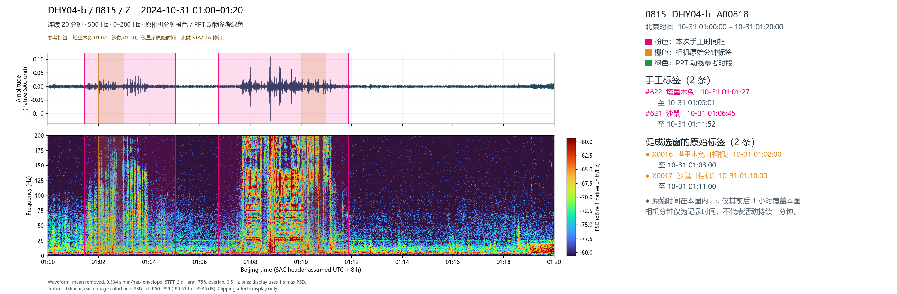

**Original PPT text (unverified):** 兔鼠对比

**Whole-image notes:** 

### ppt-s15-i1 / event 1

Reviewed label: 塔里木兔
User confidence: 高
Evidence field: 相机与经验共同支持
Time field: not supplied; use drawn region
Region: {"x": 0.09104834599703485, "y": 0.17685916884216468, "w": 0.08484004355077834, "h": 0.6895946518027235}

Description:
### 当前图：塔里木兔与沙鼠振动信号的典型对比

这张图再次展示了**塔里木兔**与**沙鼠**振动信号之间非常典型、且对比鲜明的差异：**第一个视窗为塔里木兔，第二个视窗为沙鼠。**

### Case 1：塔里木兔振动信号

第一个视窗中的信号经判定为塔里木兔活动所产生的振动。其最主要的特征是：在时频谱上表现为**一条条相互分离的竖向能量带**。这些竖向条带对应的是兔子活动过程中产生的一次次瞬态冲击事件。

从频率分布上看，虽然在某些局部频段也能隐约看到能量相对较强的区域，但这些增强通常是**较为离散、较为随机**地出现，缺乏稳定性和一致性。也就是说，塔里木兔的信号中并不存在几个持续而明确的优势频带。

此外，塔里木兔信号的另一个显著特点是：**主要只能看到竖向条带，而缺少明显的横向能量条带将这些竖向冲击事件连接起来。** 因此，其时频结构整体上显得更加离散、更加“孤立”。

### Case 2：沙鼠振动信号

第二个视窗中的信号则表现出非常典型的沙鼠特征，与塔里木兔形成了鲜明对比。

与塔里木兔一样，沙鼠活动同样会在时频谱上产生大量竖向能量条带，对应一次次跳跃或落地冲击。但沙鼠信号最突出的地方在于：**在几分钟的时间范围内，可以持续地看到某些特定频率带上存在较强的能量增强。**

这些增强通常表现为一些较稳定的**亮斑、斑块或横向条带**。它们分布在若干特定频率范围内，并在时间上具有一定连续性，因此看起来就像是用横向的能量纹理把不同时间上的竖向冲击条带连接起来。

在一些情况下，这种**横向条带**甚至比竖向冲击条带本身还要更加清晰，从而构成了沙鼠信号最具辨识度的时频特征。

### 两者的核心差异

因此，这张图非常清楚地体现了塔里木兔与沙鼠信号在时频结构上的不同：

- **塔里木兔：** 主要表现为一系列相互分离的竖向能量条带；局部频带能量增强较为随机，缺乏稳定性；基本看不到明显的横向连接结构。
- **沙鼠：** 除了竖向冲击条带外，还存在持续出现在若干特定频率带上的较强能量增强，并形成较为清晰的横向条带，将多个竖向条带连接起来。

### 总结

**这张图是塔里木兔与沙鼠振动信号差异的一个非常经典的对比例子。**  
塔里木兔的信号更偏向于离散的、孤立的瞬态冲击；而沙鼠的信号则除了竖向冲击外，还伴随着较稳定的特征频带和更明显的横向能量连接。

这种差异很可能反映了**两种动物在活动方式和行为节律上的不同**，并进一步体现在它们各自不同的时频结构之中。也正因此，这些特征有望作为区分沙鼠与塔里木兔振动信号的重要判别依据。

### ppt-s15-i1 / event 2

Reviewed label: 沙鼠
User confidence: 高
Evidence field: 相机与经验共同支持
Time field: not supplied; use drawn region
Region: {"x": 0.2629378243143069, "y": 0.17528928243843928, "w": 0.11886119347664936, "h": 0.696853171523319}

Description:
### 当前图：塔里木兔与沙鼠振动信号的典型对比

这张图再次展示了**塔里木兔**与**沙鼠**振动信号之间非常典型、且对比鲜明的差异：**第一个视窗为塔里木兔，第二个视窗为沙鼠。**

### Case 1：塔里木兔振动信号

第一个视窗中的信号经判定为塔里木兔活动所产生的振动。其最主要的特征是：在时频谱上表现为**一条条相互分离的竖向能量带**。这些竖向条带对应的是兔子活动过程中产生的一次次瞬态冲击事件。

从频率分布上看，虽然在某些局部频段也能隐约看到能量相对较强的区域，但这些增强通常是**较为离散、较为随机**地出现，缺乏稳定性和一致性。也就是说，塔里木兔的信号中并不存在几个持续而明确的优势频带。

此外，塔里木兔信号的另一个显著特点是：**主要只能看到竖向条带，而缺少明显的横向能量条带将这些竖向冲击事件连接起来。** 因此，其时频结构整体上显得更加离散、更加“孤立”。

### Case 2：沙鼠振动信号

第二个视窗中的信号则表现出非常典型的沙鼠特征，与塔里木兔形成了鲜明对比。

与塔里木兔一样，沙鼠活动同样会在时频谱上产生大量竖向能量条带，对应一次次跳跃或落地冲击。但沙鼠信号最突出的地方在于：**在几分钟的时间范围内，可以持续地看到某些特定频率带上存在较强的能量增强。**

这些增强通常表现为一些较稳定的**亮斑、斑块或横向条带**。它们分布在若干特定频率范围内，并在时间上具有一定连续性，因此看起来就像是用横向的能量纹理把不同时间上的竖向冲击条带连接起来。

在一些情况下，这种**横向条带**甚至比竖向冲击条带本身还要更加清晰，从而构成了沙鼠信号最具辨识度的时频特征。

### 两者的核心差异

因此，这张图非常清楚地体现了塔里木兔与沙鼠信号在时频结构上的不同：

- **塔里木兔：** 主要表现为一系列相互分离的竖向能量条带；局部频带能量增强较为随机，缺乏稳定性；基本看不到明显的横向连接结构。
- **沙鼠：** 除了竖向冲击条带外，还存在持续出现在若干特定频率带上的较强能量增强，并形成较为清晰的横向条带，将多个竖向条带连接起来。

### 总结

**这张图是塔里木兔与沙鼠振动信号差异的一个非常经典的对比例子。**  
塔里木兔的信号更偏向于离散的、孤立的瞬态冲击；而沙鼠的信号则除了竖向冲击外，还伴随着较稳定的特征频带和更明显的横向能量连接。

这种差异很可能反映了**两种动物在活动方式和行为节律上的不同**，并进一步体现在它们各自不同的时频结构之中。也正因此，这些特征有望作为区分沙鼠与塔里木兔振动信号的重要判别依据。

## ppt-s15-i2

Wild animal spectrugram labels 10272026.pptx / 第 15 页 / 图 2

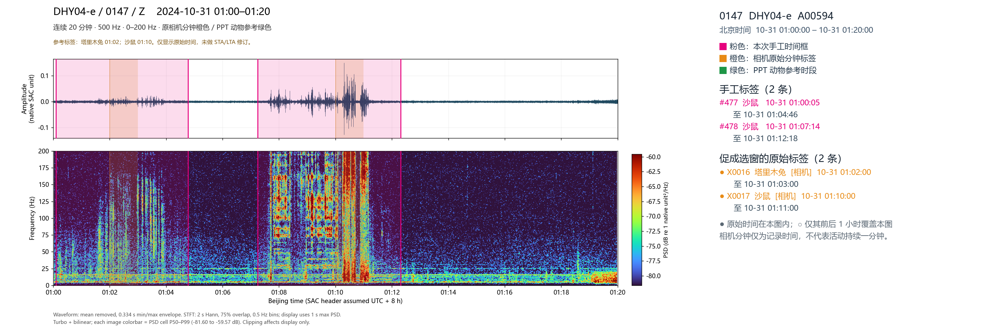

**Original PPT text (unverified):** 兔鼠对比

**Whole-image notes:** ### 当前图：塔里木兔与沙鼠振动信号的典型对比

这张图再次展示了**塔里木兔**与**沙鼠**振动信号之间非常典型、且对比鲜明的差异：**第一个视窗为塔里木兔，第二个视窗为沙鼠。**

### Case 1：塔里木兔振动信号

第一个视窗中的信号经判定为塔里木兔活动所产生的振动。其最主要的特征是：在时频谱上表现为**一条条相互分离的竖向能量带**。这些竖向条带对应的是兔子活动过程中产生的一次次瞬态冲击事件。

从频率分布上看，虽然在某些局部频段也能隐约看到能量相对较强的区域，但这些增强通常是**较为离散、较为随机**地出现，缺乏稳定性和一致性。也就是说，塔里木兔的信号中并不存在几个持续而明确的优势频带。

此外，塔里木兔信号的另一个显著特点是：**主要只能看到竖向条带，而缺少明显的横向能量条带将这些竖向冲击事件连接起来。** 因此，其时频结构整体上显得更加离散、更加“孤立”。

### Case 2：沙鼠振动信号

第二个视窗中的信号则表现出非常典型的沙鼠特征，与塔里木兔形成了鲜明对比。

与塔里木兔一样，沙鼠活动同样会在时频谱上产生大量竖向能量条带，对应一次次跳跃或落地冲击。但沙鼠信号最突出的地方在于：**在几分钟的时间范围内，可以持续地看到某些特定频率带上存在较强的能量增强。**

这些增强通常表现为一些较稳定的**亮斑、斑块或横向条带**。它们分布在若干特定频率范围内，并在时间上具有一定连续性，因此看起来就像是用横向的能量纹理把不同时间上的竖向冲击条带连接起来。

在一些情况下，这种**横向条带**甚至比竖向冲击条带本身还要更加清晰，从而构成了沙鼠信号最具辨识度的时频特征。

### 两者的核心差异

因此，这张图非常清楚地体现了塔里木兔与沙鼠信号在时频结构上的不同：

- **塔里木兔：** 主要表现为一系列相互分离的竖向能量条带；局部频带能量增强较为随机，缺乏稳定性；基本看不到明显的横向连接结构。
- **沙鼠：** 除了竖向冲击条带外，还存在持续出现在若干特定频率带上的较强能量增强，并形成较为清晰的横向条带，将多个竖向条带连接起来。

### 总结

**这张图是塔里木兔与沙鼠振动信号差异的一个非常经典的对比例子。**  
塔里木兔的信号更偏向于离散的、孤立的瞬态冲击；而沙鼠的信号则除了竖向冲击外，还伴随着较稳定的特征频带和更明显的横向能量连接。

这种差异很可能反映了**两种动物在活动方式和行为节律上的不同**，并进一步体现在它们各自不同的时频结构之中。也正因此，这些特征有望作为区分沙鼠与塔里木兔振动信号的重要判别依据。

### ppt-s15-i2 / event 1

Reviewed label: 塔里木兔
User confidence: 高
Evidence field: unspecified
Time field: not supplied; use drawn region
Region: {"x": 0.08582098704866561, "y": 0.17765222263728053, "w": 0.08782010400313972, "h": 0.6919032499066119}

Description:
### 当前图：塔里木兔与沙鼠振动信号的典型对比

这张图再次展示了**塔里木兔**与**沙鼠**振动信号之间非常典型、且对比鲜明的差异：**第一个视窗为塔里木兔，第二个视窗为沙鼠。**

### Case 1：塔里木兔振动信号

第一个视窗中的信号经判定为塔里木兔活动所产生的振动。其最主要的特征是：在时频谱上表现为**一条条相互分离的竖向能量带**。这些竖向条带对应的是兔子活动过程中产生的一次次瞬态冲击事件。

从频率分布上看，虽然在某些局部频段也能隐约看到能量相对较强的区域，但这些增强通常是**较为离散、较为随机**地出现，缺乏稳定性和一致性。也就是说，塔里木兔的信号中并不存在几个持续而明确的优势频带。

此外，塔里木兔信号的另一个显著特点是：**主要只能看到竖向条带，而缺少明显的横向能量条带将这些竖向冲击事件连接起来。** 因此，其时频结构整体上显得更加离散、更加“孤立”。

### Case 2：沙鼠振动信号

第二个视窗中的信号则表现出非常典型的沙鼠特征，与塔里木兔形成了鲜明对比。

与塔里木兔一样，沙鼠活动同样会在时频谱上产生大量竖向能量条带，对应一次次跳跃或落地冲击。但沙鼠信号最突出的地方在于：**在几分钟的时间范围内，可以持续地看到某些特定频率带上存在较强的能量增强。**

这些增强通常表现为一些较稳定的**亮斑、斑块或横向条带**。它们分布在若干特定频率范围内，并在时间上具有一定连续性，因此看起来就像是用横向的能量纹理把不同时间上的竖向冲击条带连接起来。

在一些情况下，这种**横向条带**甚至比竖向冲击条带本身还要更加清晰，从而构成了沙鼠信号最具辨识度的时频特征。

### 两者的核心差异

因此，这张图非常清楚地体现了塔里木兔与沙鼠信号在时频结构上的不同：

- **塔里木兔：** 主要表现为一系列相互分离的竖向能量条带；局部频带能量增强较为随机，缺乏稳定性；基本看不到明显的横向连接结构。
- **沙鼠：** 除了竖向冲击条带外，还存在持续出现在若干特定频率带上的较强能量增强，并形成较为清晰的横向条带，将多个竖向条带连接起来。

### 总结

**这张图是塔里木兔与沙鼠振动信号差异的一个非常经典的对比例子。**  
塔里木兔的信号更偏向于离散的、孤立的瞬态冲击；而沙鼠的信号则除了竖向冲击外，还伴随着较稳定的特征频带和更明显的横向能量连接。

这种差异很可能反映了**两种动物在活动方式和行为节律上的不同**，并进一步体现在它们各自不同的时频结构之中。也正因此，这些特征有望作为区分沙鼠与塔里木兔振动信号的重要判别依据。

### ppt-s15-i2 / event 2

Reviewed label: 沙鼠
User confidence: 高
Evidence field: 相机与经验共同支持
Time field: not supplied; use drawn region
Region: {"x": 0.25977175726059654, "y": 0.17571908853193874, "w": 0.11978757849293564, "h": 0.6863186402689578}

Description:
### 当前图：塔里木兔与沙鼠振动信号的典型对比

这张图再次展示了**塔里木兔**与**沙鼠**振动信号之间非常典型、且对比鲜明的差异：**第一个视窗为塔里木兔，第二个视窗为沙鼠。**

### Case 1：塔里木兔振动信号

第一个视窗中的信号经判定为塔里木兔活动所产生的振动。其最主要的特征是：在时频谱上表现为**一条条相互分离的竖向能量带**。这些竖向条带对应的是兔子活动过程中产生的一次次瞬态冲击事件。

从频率分布上看，虽然在某些局部频段也能隐约看到能量相对较强的区域，但这些增强通常是**较为离散、较为随机**地出现，缺乏稳定性和一致性。也就是说，塔里木兔的信号中并不存在几个持续而明确的优势频带。

此外，塔里木兔信号的另一个显著特点是：**主要只能看到竖向条带，而缺少明显的横向能量条带将这些竖向冲击事件连接起来。** 因此，其时频结构整体上显得更加离散、更加“孤立”。

### Case 2：沙鼠振动信号

第二个视窗中的信号则表现出非常典型的沙鼠特征，与塔里木兔形成了鲜明对比。

与塔里木兔一样，沙鼠活动同样会在时频谱上产生大量竖向能量条带，对应一次次跳跃或落地冲击。但沙鼠信号最突出的地方在于：**在几分钟的时间范围内，可以持续地看到某些特定频率带上存在较强的能量增强。**

这些增强通常表现为一些较稳定的**亮斑、斑块或横向条带**。它们分布在若干特定频率范围内，并在时间上具有一定连续性，因此看起来就像是用横向的能量纹理把不同时间上的竖向冲击条带连接起来。

在一些情况下，这种**横向条带**甚至比竖向冲击条带本身还要更加清晰，从而构成了沙鼠信号最具辨识度的时频特征。

### 两者的核心差异

因此，这张图非常清楚地体现了塔里木兔与沙鼠信号在时频结构上的不同：

- **塔里木兔：** 主要表现为一系列相互分离的竖向能量条带；局部频带能量增强较为随机，缺乏稳定性；基本看不到明显的横向连接结构。
- **沙鼠：** 除了竖向冲击条带外，还存在持续出现在若干特定频率带上的较强能量增强，并形成较为清晰的横向条带，将多个竖向条带连接起来。

### 总结

**这张图是塔里木兔与沙鼠振动信号差异的一个非常经典的对比例子。**  
塔里木兔的信号更偏向于离散的、孤立的瞬态冲击；而沙鼠的信号则除了竖向冲击外，还伴随着较稳定的特征频带和更明显的横向能量连接。

这种差异很可能反映了**两种动物在活动方式和行为节律上的不同**，并进一步体现在它们各自不同的时频结构之中。也正因此，这些特征有望作为区分沙鼠与塔里木兔振动信号的重要判别依据。

## ppt-s15-i3

Wild animal spectrugram labels 10272026.pptx / 第 15 页 / 图 3

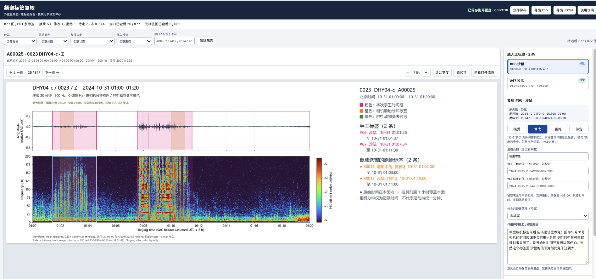

**Original PPT text (unverified):** 兔鼠对比

**Whole-image notes:** 

### ppt-s15-i3 / event 1

Reviewed label: 塔里木兔
User confidence: 高
Evidence field: unspecified
Time field: not supplied; use drawn region
Region: {"x": 0.08504525608320251, "y": 0.3925590643886869, "w": 0.0708950647566719, "h": 0.4084011407341514}

Description:
### 当前图：塔里木兔与沙鼠振动信号的典型对比

这张图再次展示了**塔里木兔**与**沙鼠**振动信号之间非常典型、且对比鲜明的差异：**第一个视窗为塔里木兔，第二个视窗为沙鼠。**

### Case 1：塔里木兔振动信号

第一个视窗中的信号经判定为塔里木兔活动所产生的振动。其最主要的特征是：在时频谱上表现为**一条条相互分离的竖向能量带**。这些竖向条带对应的是兔子活动过程中产生的一次次瞬态冲击事件。

从频率分布上看，虽然在某些局部频段也能隐约看到能量相对较强的区域，但这些增强通常是**较为离散、较为随机**地出现，缺乏稳定性和一致性。也就是说，塔里木兔的信号中并不存在几个持续而明确的优势频带。

此外，塔里木兔信号的另一个显著特点是：**主要只能看到竖向条带，而缺少明显的横向能量条带将这些竖向冲击事件连接起来。** 因此，其时频结构整体上显得更加离散、更加“孤立”。

### Case 2：沙鼠振动信号

第二个视窗中的信号则表现出非常典型的沙鼠特征，与塔里木兔形成了鲜明对比。

与塔里木兔一样，沙鼠活动同样会在时频谱上产生大量竖向能量条带，对应一次次跳跃或落地冲击。但沙鼠信号最突出的地方在于：**在几分钟的时间范围内，可以持续地看到某些特定频率带上存在较强的能量增强。**

这些增强通常表现为一些较稳定的**亮斑、斑块或横向条带**。它们分布在若干特定频率范围内，并在时间上具有一定连续性，因此看起来就像是用横向的能量纹理把不同时间上的竖向冲击条带连接起来。

在一些情况下，这种**横向条带**甚至比竖向冲击条带本身还要更加清晰，从而构成了沙鼠信号最具辨识度的时频特征。

### 两者的核心差异

因此，这张图非常清楚地体现了塔里木兔与沙鼠信号在时频结构上的不同：

- **塔里木兔：** 主要表现为一系列相互分离的竖向能量条带；局部频带能量增强较为随机，缺乏稳定性；基本看不到明显的横向连接结构。
- **沙鼠：** 除了竖向冲击条带外，还存在持续出现在若干特定频率带上的较强能量增强，并形成较为清晰的横向条带，将多个竖向条带连接起来。

### 总结

**这张图是塔里木兔与沙鼠振动信号差异的一个非常经典的对比例子。**  
塔里木兔的信号更偏向于离散的、孤立的瞬态冲击；而沙鼠的信号则除了竖向冲击外，还伴随着较稳定的特征频带和更明显的横向能量连接。

这种差异很可能反映了**两种动物在活动方式和行为节律上的不同**，并进一步体现在它们各自不同的时频结构之中。也正因此，这些特征有望作为区分沙鼠与塔里木兔振动信号的重要判别依据。

### ppt-s15-i3 / event 2

Reviewed label: 沙鼠
User confidence: 高
Evidence field: 相机与经验共同支持
Time field: not supplied; use drawn region
Region: {"x": 0.22619149823390894, "y": 0.3972292718662515, "w": 0.09288841738618525, "h": 0.3974647445121792}

Description:
### 当前图：塔里木兔与沙鼠振动信号的典型对比

这张图再次展示了**塔里木兔**与**沙鼠**振动信号之间非常典型、且对比鲜明的差异：**第一个视窗为塔里木兔，第二个视窗为沙鼠。**

### Case 1：塔里木兔振动信号

第一个视窗中的信号经判定为塔里木兔活动所产生的振动。其最主要的特征是：在时频谱上表现为**一条条相互分离的竖向能量带**。这些竖向条带对应的是兔子活动过程中产生的一次次瞬态冲击事件。

从频率分布上看，虽然在某些局部频段也能隐约看到能量相对较强的区域，但这些增强通常是**较为离散、较为随机**地出现，缺乏稳定性和一致性。也就是说，塔里木兔的信号中并不存在几个持续而明确的优势频带。

此外，塔里木兔信号的另一个显著特点是：**主要只能看到竖向条带，而缺少明显的横向能量条带将这些竖向冲击事件连接起来。** 因此，其时频结构整体上显得更加离散、更加“孤立”。

### Case 2：沙鼠振动信号

第二个视窗中的信号则表现出非常典型的沙鼠特征，与塔里木兔形成了鲜明对比。

与塔里木兔一样，沙鼠活动同样会在时频谱上产生大量竖向能量条带，对应一次次跳跃或落地冲击。但沙鼠信号最突出的地方在于：**在几分钟的时间范围内，可以持续地看到某些特定频率带上存在较强的能量增强。**

这些增强通常表现为一些较稳定的**亮斑、斑块或横向条带**。它们分布在若干特定频率范围内，并在时间上具有一定连续性，因此看起来就像是用横向的能量纹理把不同时间上的竖向冲击条带连接起来。

在一些情况下，这种**横向条带**甚至比竖向冲击条带本身还要更加清晰，从而构成了沙鼠信号最具辨识度的时频特征。

### 两者的核心差异

因此，这张图非常清楚地体现了塔里木兔与沙鼠信号在时频结构上的不同：

- **塔里木兔：** 主要表现为一系列相互分离的竖向能量条带；局部频带能量增强较为随机，缺乏稳定性；基本看不到明显的横向连接结构。
- **沙鼠：** 除了竖向冲击条带外，还存在持续出现在若干特定频率带上的较强能量增强，并形成较为清晰的横向条带，将多个竖向条带连接起来。

### 总结

**这张图是塔里木兔与沙鼠振动信号差异的一个非常经典的对比例子。**  
塔里木兔的信号更偏向于离散的、孤立的瞬态冲击；而沙鼠的信号则除了竖向冲击外，还伴随着较稳定的特征频带和更明显的横向能量连接。

这种差异很可能反映了**两种动物在活动方式和行为节律上的不同**，并进一步体现在它们各自不同的时频结构之中。也正因此，这些特征有望作为区分沙鼠与塔里木兔振动信号的重要判别依据。

## ppt-s15-i4

Wild animal spectrugram labels 10272026.pptx / 第 15 页 / 图 4

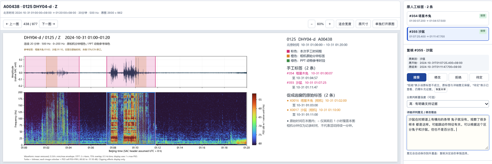

**Original PPT text (unverified):** 兔鼠对比

**Whole-image notes:** 

### ppt-s15-i4 / event 1

Reviewed label: 塔里木兔
User confidence: 高
Evidence field: 相机与经验共同支持
Time field: not supplied; use drawn region
Region: {"x": 0.07501287774725275, "y": 0.33483365591790526, "w": 0.07379869014913658, "h": 0.5547602527115364}

Description:
### 当前图：塔里木兔与沙鼠振动信号的典型对比

这张图再次展示了**塔里木兔**与**沙鼠**振动信号之间非常典型、且对比鲜明的差异：**第一个视窗为塔里木兔，第二个视窗为沙鼠。**

### Case 1：塔里木兔振动信号

第一个视窗中的信号经判定为塔里木兔活动所产生的振动。其最主要的特征是：在时频谱上表现为**一条条相互分离的竖向能量带**。这些竖向条带对应的是兔子活动过程中产生的一次次瞬态冲击事件。

从频率分布上看，虽然在某些局部频段也能隐约看到能量相对较强的区域，但这些增强通常是**较为离散、较为随机**地出现，缺乏稳定性和一致性。也就是说，塔里木兔的信号中并不存在几个持续而明确的优势频带。

此外，塔里木兔信号的另一个显著特点是：**主要只能看到竖向条带，而缺少明显的横向能量条带将这些竖向冲击事件连接起来。** 因此，其时频结构整体上显得更加离散、更加“孤立”。

### Case 2：沙鼠振动信号

第二个视窗中的信号则表现出非常典型的沙鼠特征，与塔里木兔形成了鲜明对比。

与塔里木兔一样，沙鼠活动同样会在时频谱上产生大量竖向能量条带，对应一次次跳跃或落地冲击。但沙鼠信号最突出的地方在于：**在几分钟的时间范围内，可以持续地看到某些特定频率带上存在较强的能量增强。**

这些增强通常表现为一些较稳定的**亮斑、斑块或横向条带**。它们分布在若干特定频率范围内，并在时间上具有一定连续性，因此看起来就像是用横向的能量纹理把不同时间上的竖向冲击条带连接起来。

在一些情况下，这种**横向条带**甚至比竖向冲击条带本身还要更加清晰，从而构成了沙鼠信号最具辨识度的时频特征。

### 两者的核心差异

因此，这张图非常清楚地体现了塔里木兔与沙鼠信号在时频结构上的不同：

- **塔里木兔：** 主要表现为一系列相互分离的竖向能量条带；局部频带能量增强较为随机，缺乏稳定性；基本看不到明显的横向连接结构。
- **沙鼠：** 除了竖向冲击条带外，还存在持续出现在若干特定频率带上的较强能量增强，并形成较为清晰的横向条带，将多个竖向条带连接起来。

### 总结

**这张图是塔里木兔与沙鼠振动信号差异的一个非常经典的对比例子。**  
塔里木兔的信号更偏向于离散的、孤立的瞬态冲击；而沙鼠的信号则除了竖向冲击外，还伴随着较稳定的特征频带和更明显的横向能量连接。

这种差异很可能反映了**两种动物在活动方式和行为节律上的不同**，并进一步体现在它们各自不同的时频结构之中。也正因此，这些特征有望作为区分沙鼠与塔里木兔振动信号的重要判别依据。

### ppt-s15-i4 / event 2

Reviewed label: 沙鼠
User confidence: 高
Evidence field: 相机与经验共同支持
Time field: not supplied; use drawn region
Region: {"x": 0.21556735675039246, "y": 0.33673264434137967, "w": 0.09336979984301413, "h": 0.5489628601687178}

Description:
### 当前图：塔里木兔与沙鼠振动信号的典型对比

这张图再次展示了**塔里木兔**与**沙鼠**振动信号之间非常典型、且对比鲜明的差异：**第一个视窗为塔里木兔，第二个视窗为沙鼠。**

### Case 1：塔里木兔振动信号

第一个视窗中的信号经判定为塔里木兔活动所产生的振动。其最主要的特征是：在时频谱上表现为**一条条相互分离的竖向能量带**。这些竖向条带对应的是兔子活动过程中产生的一次次瞬态冲击事件。

从频率分布上看，虽然在某些局部频段也能隐约看到能量相对较强的区域，但这些增强通常是**较为离散、较为随机**地出现，缺乏稳定性和一致性。也就是说，塔里木兔的信号中并不存在几个持续而明确的优势频带。

此外，塔里木兔信号的另一个显著特点是：**主要只能看到竖向条带，而缺少明显的横向能量条带将这些竖向冲击事件连接起来。** 因此，其时频结构整体上显得更加离散、更加“孤立”。

### Case 2：沙鼠振动信号

第二个视窗中的信号则表现出非常典型的沙鼠特征，与塔里木兔形成了鲜明对比。

与塔里木兔一样，沙鼠活动同样会在时频谱上产生大量竖向能量条带，对应一次次跳跃或落地冲击。但沙鼠信号最突出的地方在于：**在几分钟的时间范围内，可以持续地看到某些特定频率带上存在较强的能量增强。**

这些增强通常表现为一些较稳定的**亮斑、斑块或横向条带**。它们分布在若干特定频率范围内，并在时间上具有一定连续性，因此看起来就像是用横向的能量纹理把不同时间上的竖向冲击条带连接起来。

在一些情况下，这种**横向条带**甚至比竖向冲击条带本身还要更加清晰，从而构成了沙鼠信号最具辨识度的时频特征。

### 两者的核心差异

因此，这张图非常清楚地体现了塔里木兔与沙鼠信号在时频结构上的不同：

- **塔里木兔：** 主要表现为一系列相互分离的竖向能量条带；局部频带能量增强较为随机，缺乏稳定性；基本看不到明显的横向连接结构。
- **沙鼠：** 除了竖向冲击条带外，还存在持续出现在若干特定频率带上的较强能量增强，并形成较为清晰的横向条带，将多个竖向条带连接起来。

### 总结

**这张图是塔里木兔与沙鼠振动信号差异的一个非常经典的对比例子。**  
塔里木兔的信号更偏向于离散的、孤立的瞬态冲击；而沙鼠的信号则除了竖向冲击外，还伴随着较稳定的特征频带和更明显的横向能量连接。

这种差异很可能反映了**两种动物在活动方式和行为节律上的不同**，并进一步体现在它们各自不同的时频结构之中。也正因此，这些特征有望作为区分沙鼠与塔里木兔振动信号的重要判别依据。

## ppt-s16-i1

Wild animal spectrugram labels 10272026.pptx / 第 16 页 / 图 1

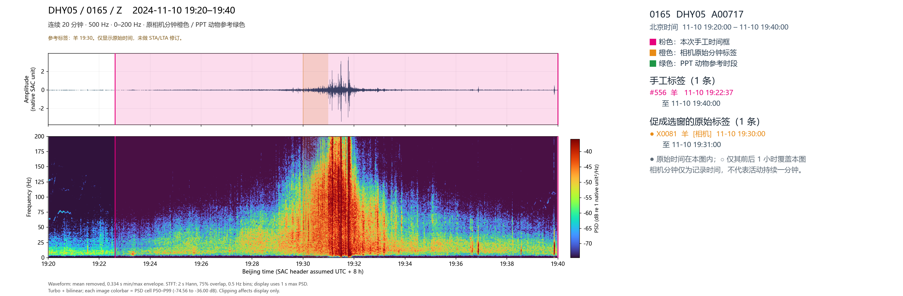

**Original PPT text (unverified):** 典型羊的信号

**Whole-image notes:** 

### ppt-s16-i1 / event 1

Reviewed label: 羊群
User confidence: 高
Evidence field: 相机与经验共同支持
Time field: not supplied; use drawn region
Region: {"x": 0.12774725274725274, "y": 0.1785113933507658, "w": 0.4894617101648352, "h": 0.6981602540156892}

Description:
### 当前图：典型羊群活动产生的振动信号

该案例展示了羊群经过观测台站时产生的典型地面振动信号。与此前分析的车辆信号相比，羊群信号虽然也具有近似三角形的时频包络，但在**持续时间、内部脉冲结构以及高频变频特征**等方面存在明显区别。

**1. 持续时间较长：接近20分钟**

该信号最显著的特征之一是持续时间较长，整个羊群活动过程接近 **20分钟**，在这一时间范围内均可以观察到较明显的振动扰动。

这主要与羊群的集群活动方式有关。由于羊群通常成群结队行走，且队列可能具有较长的空间延伸范围，不同个体会在较长时间内陆续经过观测台站，因此产生持续时间较长的振动响应。

**2. 时频谱呈宽扁的三角形结构**

在时频谱上，羊群信号整体同样呈现近似三角形的能量分布，但与车辆信号相比，其三角形在时间方向上明显更加宽展，表现为一个**持续时间较长、形态相对扁平的三角形包络**。

随着羊群逐渐接近观测台站，整体振动能量增强；当羊群的主要部分经过距离台站较近的区域时，信号达到较强水平；随后随着羊群逐渐远离，振动能量逐步减弱。

需要注意，这种时频包络的视觉形态也会受到颜色标尺（color bar）动态范围及绘图尺度的影响，因此不能仅凭三角形的宽窄判断信号来源。

**3. 内部由大量竖向脉冲条带组成**

与车辆信号较为连续的时频能量分布不同，羊群信号内部可以观察到**大量密集分布的竖向能量条带**。

这些竖向条带可能对应羊群中不同个体行走时，蹄部踩踏地面所产生的瞬态冲击振动。

由于羊群包含大量个体，且各个个体的步伐并不同步，因此这些冲击信号在时间上呈现出密集、复杂且不规则的分布，形成长时间持续的脉冲序列。

因此，羊群信号可以理解为：**大量离散的踩踏冲击事件在较长时间内叠加，形成一个整体连续、内部具有密集脉冲结构的振动过程。**

**4. 与车辆信号的关键区别：缺少典型发动机变频轨迹**

这是区分羊群与车辆振动信号的重要依据。

虽然车辆与羊群都可能产生近似三角形的时频包络，但车辆通常伴随发动机及相关旋转机械产生的**窄带变频信号及谐波结构**。这些信号在时频谱上表现为随时间升高或降低的连续或断续频率曲线。

相比之下，羊群活动主要由大量蹄部冲击产生，不具备与发动机旋转相关的稳定变频及谐波机制，因此通常不会出现车辆特有的成组窄带变频轨迹。

### 羊群与车辆振动信号的主要区别

| 特征 | 羊群 | 车辆 |
|---|---|---|
| 持续时间 | 可达约20分钟 | 典型单车事件为分钟量级 |
| 时频谱整体形态 | 宽扁的近似三角形 | 相对紧凑的近似三角形 |
| 内部时频结构 | 大量密集、离散的竖向冲击条带 | 相对连续的能量包络 |
| 主要振动机制 | 多只羊的蹄部踩踏冲击 | 车辆行驶、轮胎与路面作用及机械振动 |
| 高频窄带变频轨迹 | 通常不明显 | 常可观察到发动机相关的变频及谐波结构 |
| 时间分布 | 大量个体先后经过，扰动持续较长 | 单车经过时相对集中 |

### 总结

**羊群信号最具代表性的特征是：持续时间长、时频包络宽扁、内部包含大量密集的竖向冲击条带，同时缺少车辆发动机所产生的典型窄带变频及谐波轨迹。**

特别需要强调的是，虽然羊群与车辆都可以形成近似三角形的时频包络，但**密集的踩踏冲击结构，以及是否存在发动机相关的窄带变频轨迹，是区分两类信号的重要依据**。

因此，在实际识别中，应综合考虑事件持续时间、时频包络形态、内部脉冲结构和变频特征，而不是仅依据三角形轮廓进行分类。

## ppt-s16-i2

Wild animal spectrugram labels 10272026.pptx / 第 16 页 / 图 2

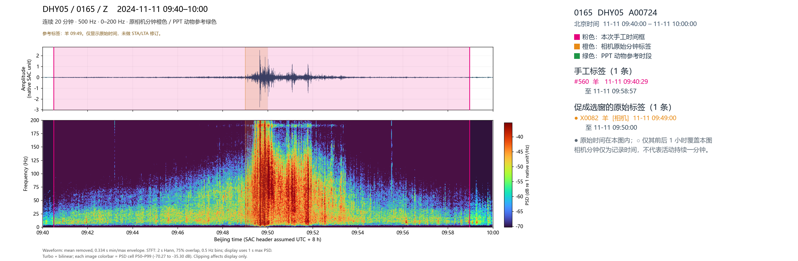

**Original PPT text (unverified):** 典型羊的信号

**Whole-image notes:** 

### ppt-s16-i2 / event 1

Reviewed label: 羊群
User confidence: 高
Evidence field: 相机确认，已核对对应时段
Time field: not supplied; use drawn region
Region: {"x": 0.06577499536693847, "y": 0.1764358286883511, "w": 0.5255716039659007, "h": 0.6965092076483455}

Description:
### 当前图：典型羊群活动产生的振动信号

该案例展示了羊群经过观测台站时产生的典型地面振动信号。与此前分析的车辆信号相比，羊群信号虽然也具有近似三角形的时频包络，但在**持续时间、内部脉冲结构以及高频变频特征**等方面存在明显区别。

**1. 持续时间较长：接近20分钟**

该信号最显著的特征之一是持续时间较长，整个羊群活动过程接近 **20分钟**，在这一时间范围内均可以观察到较明显的振动扰动。

这主要与羊群的集群活动方式有关。由于羊群通常成群结队行走，且队列可能具有较长的空间延伸范围，不同个体会在较长时间内陆续经过观测台站，因此产生持续时间较长的振动响应。

**2. 时频谱呈宽扁的三角形结构**

在时频谱上，羊群信号整体同样呈现近似三角形的能量分布，但与车辆信号相比，其三角形在时间方向上明显更加宽展，表现为一个**持续时间较长、形态相对扁平的三角形包络**。

随着羊群逐渐接近观测台站，整体振动能量增强；当羊群的主要部分经过距离台站较近的区域时，信号达到较强水平；随后随着羊群逐渐远离，振动能量逐步减弱。

需要注意，这种时频包络的视觉形态也会受到颜色标尺（color bar）动态范围及绘图尺度的影响，因此不能仅凭三角形的宽窄判断信号来源。

**3. 内部由大量竖向脉冲条带组成**

与车辆信号较为连续的时频能量分布不同，羊群信号内部可以观察到**大量密集分布的竖向能量条带**。

这些竖向条带可能对应羊群中不同个体行走时，蹄部踩踏地面所产生的瞬态冲击振动。

由于羊群包含大量个体，且各个个体的步伐并不同步，因此这些冲击信号在时间上呈现出密集、复杂且不规则的分布，形成长时间持续的脉冲序列。

因此，羊群信号可以理解为：**大量离散的踩踏冲击事件在较长时间内叠加，形成一个整体连续、内部具有密集脉冲结构的振动过程。**

**4. 与车辆信号的关键区别：缺少典型发动机变频轨迹**

这是区分羊群与车辆振动信号的重要依据。

虽然车辆与羊群都可能产生近似三角形的时频包络，但车辆通常伴随发动机及相关旋转机械产生的**窄带变频信号及谐波结构**。这些信号在时频谱上表现为随时间升高或降低的连续或断续频率曲线。

相比之下，羊群活动主要由大量蹄部冲击产生，不具备与发动机旋转相关的稳定变频及谐波机制，因此通常不会出现车辆特有的成组窄带变频轨迹。

### 羊群与车辆振动信号的主要区别

| 特征 | 羊群 | 车辆 |
|---|---|---|
| 持续时间 | 可达约20分钟 | 典型单车事件为分钟量级 |
| 时频谱整体形态 | 宽扁的近似三角形 | 相对紧凑的近似三角形 |
| 内部时频结构 | 大量密集、离散的竖向冲击条带 | 相对连续的能量包络 |
| 主要振动机制 | 多只羊的蹄部踩踏冲击 | 车辆行驶、轮胎与路面作用及机械振动 |
| 高频窄带变频轨迹 | 通常不明显 | 常可观察到发动机相关的变频及谐波结构 |
| 时间分布 | 大量个体先后经过，扰动持续较长 | 单车经过时相对集中 |

### 总结

**羊群信号最具代表性的特征是：持续时间长、时频包络宽扁、内部包含大量密集的竖向冲击条带，同时缺少车辆发动机所产生的典型窄带变频及谐波轨迹。**

特别需要强调的是，虽然羊群与车辆都可以形成近似三角形的时频包络，但**密集的踩踏冲击结构，以及是否存在发动机相关的窄带变频轨迹，是区分两类信号的重要依据**。

因此，在实际识别中，应综合考虑事件持续时间、时频包络形态、内部脉冲结构和变频特征，而不是仅依据三角形轮廓进行分类。

## ppt-s17-i1

Wild animal spectrugram labels 10272026.pptx / 第 17 页 / 图 1

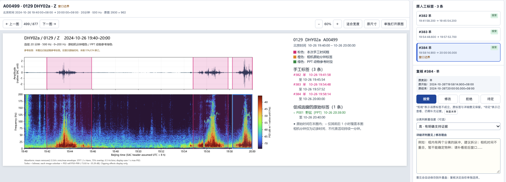

**Original PPT text (unverified):** 不是羊群
 是车；
02
台在公路边

**Whole-image notes:** 

### ppt-s17-i1 / event 1

Reviewed label: 车辆
User confidence: 高
Evidence field: unspecified
Time field: not supplied; use drawn region
Region: {"x": 0.09096726742031135, "y": 0.31217254347336953, "w": 0.08092221089696071, "h": 0.5071196682845296}

Description:
### 当前图：公路上多辆车辆经过产生的振动信号

该案例展示了**公路上三辆车经过观测台站所产生的振动信号**，图中包含两个信号片段，整体特征非常清晰，与此前沙漠中车辆产生的振动信号具有较高的一致性。

**1. 时域波形特征**

整个车辆活动过程持续约 **3–4 分钟**。信号中可以辨认出多个相对独立的振动响应，整体仍表现出车辆由远及近时振幅逐渐增强、随后随着车辆远离而逐渐减弱的典型包络特征。

**2. 时频谱特征**

在时频谱上，可以观察到**三个较为清晰的正三角形能量结构**，分别对应三辆车经过台站时产生的振动响应。

与此前部分沙漠车辆信号中两侧边界呈明显弧线的情况有所不同，本案例中三角形的两侧边界相对平直，但整体仍保持典型的三角形时频分布特征。

**3. 高频变频信号**

该案例中的高频窄带变频信号不如此前部分车辆案例清晰，但仔细观察仍能辨认出一些随时间变化的频率轨迹。这些信号可能与车辆发动机及相关机械部件的振动有关，进一步支持车辆来源的判断。

**4. 公路车辆与沙漠车辆的对比**

需要特别指出，前面几个车辆案例主要来自沙漠环境中的车辆活动，而本案例对应的是**公路上行驶的车辆**。

尽管道路条件不同，两种环境下的车辆信号仍表现出相似的基本特征，包括时域中的振幅包络、时频谱中的近似三角形能量分布，以及不同程度的高频窄带变频信号。

**总体而言，该案例展示了公路车辆振动信号的典型形态：在约 3–4 分钟内出现三个相对清晰的三角形时频结构，两侧边界较为平直，并伴有相对较弱但仍可辨认的高频变频信号。这些特征与车辆活动高度一致，也表明此前识别出的车辆信号特征在沙漠道路和公路环境中均具有一定的适用性。**

### ppt-s17-i1 / event 2

Reviewed label: 车辆
User confidence: 高
Evidence field: unspecified
Time field: not supplied; use drawn region
Region: {"x": 0.38288489158636024, "y": 0.315627912956832, "w": 0.0643184766493699, "h": 0.5035035839413712}

Description:
### 当前图：公路上多辆车辆经过产生的振动信号

该案例展示了**公路上三辆车经过观测台站所产生的振动信号**，图中包含两个信号片段，整体特征非常清晰，与此前沙漠中车辆产生的振动信号具有较高的一致性。

**1. 时域波形特征**

整个车辆活动过程持续约 **3–4 分钟**。信号中可以辨认出多个相对独立的振动响应，整体仍表现出车辆由远及近时振幅逐渐增强、随后随着车辆远离而逐渐减弱的典型包络特征。

**2. 时频谱特征**

在时频谱上，可以观察到**三个较为清晰的正三角形能量结构**，分别对应三辆车经过台站时产生的振动响应。

与此前部分沙漠车辆信号中两侧边界呈明显弧线的情况有所不同，本案例中三角形的两侧边界相对平直，但整体仍保持典型的三角形时频分布特征。

**3. 高频变频信号**

该案例中的高频窄带变频信号不如此前部分车辆案例清晰，但仔细观察仍能辨认出一些随时间变化的频率轨迹。这些信号可能与车辆发动机及相关机械部件的振动有关，进一步支持车辆来源的判断。

**4. 公路车辆与沙漠车辆的对比**

需要特别指出，前面几个车辆案例主要来自沙漠环境中的车辆活动，而本案例对应的是**公路上行驶的车辆**。

尽管道路条件不同，两种环境下的车辆信号仍表现出相似的基本特征，包括时域中的振幅包络、时频谱中的近似三角形能量分布，以及不同程度的高频窄带变频信号。

**总体而言，该案例展示了公路车辆振动信号的典型形态：在约 3–4 分钟内出现三个相对清晰的三角形时频结构，两侧边界较为平直，并伴有相对较弱但仍可辨认的高频变频信号。这些特征与车辆活动高度一致，也表明此前识别出的车辆信号特征在沙漠道路和公路环境中均具有一定的适用性。**

### ppt-s17-i1 / event 3

Reviewed label: 车辆
User confidence: 高
Evidence field: 主要依据波形 / 时频谱经验
Time field: not supplied; use drawn region
Region: {"x": 0.45839800315048185, "y": 0.3160297001060718, "w": 0.04123135192735361, "h": 0.5010366108450387}

Description:
### 当前图：公路上多辆车辆经过产生的振动信号

该案例展示了**公路上三辆车经过观测台站所产生的振动信号**，图中包含两个信号片段，整体特征非常清晰，与此前沙漠中车辆产生的振动信号具有较高的一致性。

**1. 时域波形特征**

整个车辆活动过程持续约 **3–4 分钟**。信号中可以辨认出多个相对独立的振动响应，整体仍表现出车辆由远及近时振幅逐渐增强、随后随着车辆远离而逐渐减弱的典型包络特征。

**2. 时频谱特征**

在时频谱上，可以观察到**三个较为清晰的正三角形能量结构**，分别对应三辆车经过台站时产生的振动响应。

与此前部分沙漠车辆信号中两侧边界呈明显弧线的情况有所不同，本案例中三角形的两侧边界相对平直，但整体仍保持典型的三角形时频分布特征。

**3. 高频变频信号**

该案例中的高频窄带变频信号不如此前部分车辆案例清晰，但仔细观察仍能辨认出一些随时间变化的频率轨迹。这些信号可能与车辆发动机及相关机械部件的振动有关，进一步支持车辆来源的判断。

**4. 公路车辆与沙漠车辆的对比**

需要特别指出，前面几个车辆案例主要来自沙漠环境中的车辆活动，而本案例对应的是**公路上行驶的车辆**。

尽管道路条件不同，两种环境下的车辆信号仍表现出相似的基本特征，包括时域中的振幅包络、时频谱中的近似三角形能量分布，以及不同程度的高频窄带变频信号。

**总体而言，该案例展示了公路车辆振动信号的典型形态：在约 3–4 分钟内出现三个相对清晰的三角形时频结构，两侧边界较为平直，并伴有相对较弱但仍可辨认的高频变频信号。这些特征与车辆活动高度一致，也表明此前识别出的车辆信号特征在沙漠道路和公路环境中均具有一定的适用性。**

## ppt-s23-i1

Wild animal spectrugram labels 10272026.pptx / 第 23 页 / 图 1

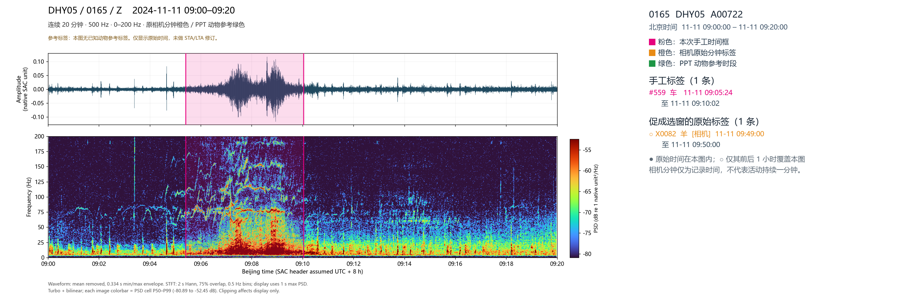

**Original PPT text (unverified):** 典型车辆信号

**Whole-image notes:** 

### ppt-s23-i1 / event 1

Reviewed label: 车辆
User confidence: 高
Evidence field: 主要依据波形 / 时频谱经验
Time field: not supplied; use drawn region
Region: {"x": 0.20454097942920682, "y": 0.164688139420024, "w": 0.1348423600815419, "h": 0.6996930783884852}

Description:
### 当前图：两辆车先后经过产生的振动信号

该案例展示了非常典型的**两辆车先后经过观测台站所产生的振动信号**。无论是时域波形还是时频谱，都可以清晰地识别出两个相对独立的车辆事件。

**1. 时域波形特征**

时域波形中出现两个明显分离的振幅峰值，每个峰值均具有车辆接近时振幅逐渐增强、远离时逐渐减弱的典型包络特征。

两个峰值在时间上先后出现，表明很可能有两辆车相继经过观测台站，而非单辆车产生的连续振动响应。

**2. 时频谱特征**

在时频谱上，可以清楚地观察到**两个相对独立的正三角形能量分布**。每个三角形均具有典型的弧形边界，反映出车辆由远及近、再逐渐远离的过程。

两个三角形在时间方向上相互分离，与时域波形中的两个独立峰值一一对应。

**3. 高频变频特征**

该案例中，高频段的窄带变频信号尤为清晰。可以观察到多条随时间变化的频率轨迹，可能对应车辆发动机及其他旋转机械部件产生的振动及其谐波成分。

这些变频特征进一步支持两个事件均来自车辆活动的判断。

**总体而言，该案例最突出的特点是时域中出现两个分离的振幅峰值，时频谱中对应出现两个独立、清晰的正三角形能量结构，同时伴有显著的高频窄带变频信号。综合这些特征，可以高度可信地判断，这是两辆车先后经过观测台站所产生的振动信号。**